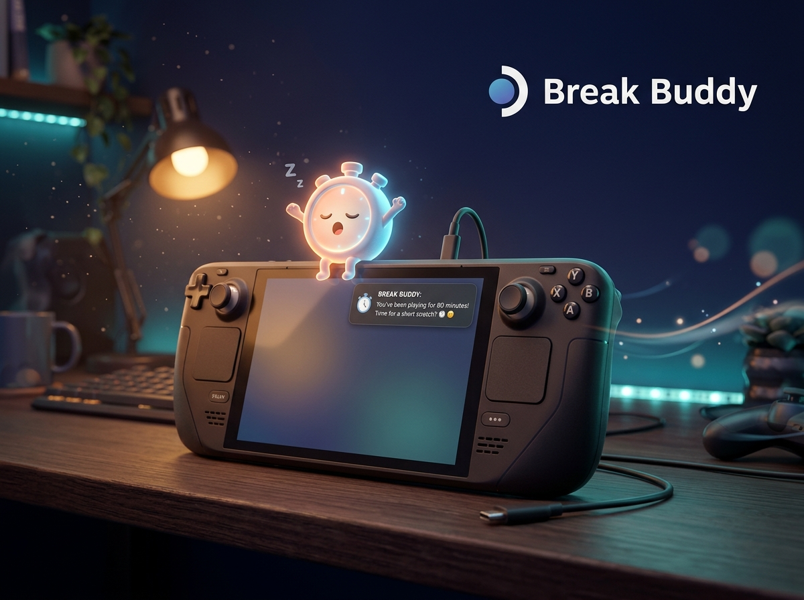

  

<h1 align="center">Break Buddy</h1>

  <b>A tiny friend for your Steam Deck that reminds you to take care of yourself.</b> 
  Gentle nudges. No pausing your game. No fuss.

---

## ✨ What it does

Break Buddy pops up a small message while you play, so you remember to:

| | Reminder | Every |
|---|---|---|
| 👀 | **Eye break**: look away for 20 seconds | 20 min |
| 💧 | **Drink some water** | 30 min |
| 🧍 | **Fix your posture** | 20 min |
| 🙌 | **Stretch your hands** | 45 min |

Want something else? Add your own, like **"Walk the dog"**, as a one-time timer or a repeating one.

## 🎮 How to use it

1. Open the **Quick Access Menu** (the `...` button).
2. Find **Break Buddy** in the Decky tab.
3. Flip on the reminders you like and pick how often.

That's it. Eye breaks are on by default; the rest are up to you.

## 💤 Sleep-friendly

Put your Deck to sleep, restart it, whatever. Your timers pick up right where they should.

## 📦 Install

Break Buddy needs [Decky Loader](https://decky.xyz) on your Steam Deck.

1. Download the latest zip from [Releases](../../releases).
2. In Decky settings, choose **Install plugin from zip**.
3. Done!

## 🙋 Good to know

- Reminders are just friendly messages. Nothing to tap, nothing gets paused.
- Works in Gaming Mode.
- Made by [Syreese](https://github.com/SyreeseOfficial).

## 📄 License

BSD-3-Clause. See [LICENSE](LICENSE).

Now go drink some water. 💧

